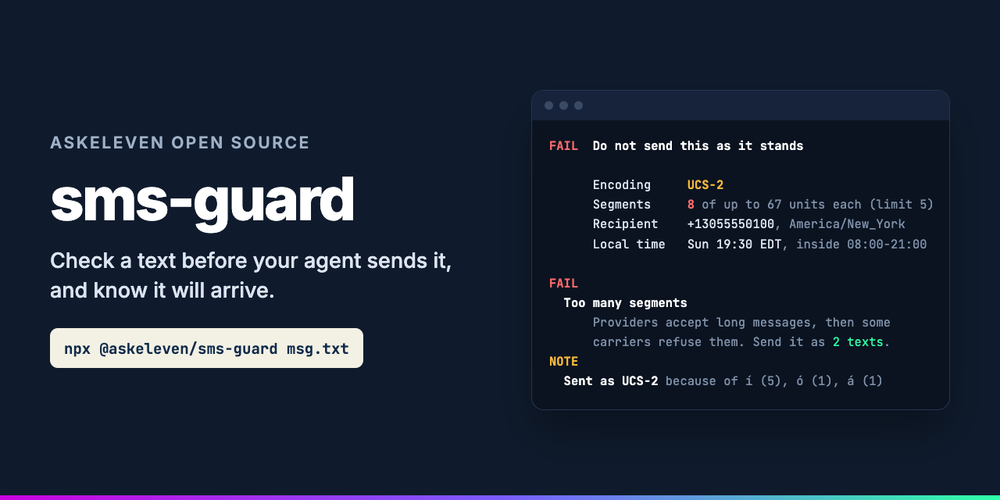

# sms-guard



**Check a text message before your agent sends it, and find out whether it will arrive.**

```bash
npx @askeleven/sms-guard "Hi Ana, your table for 4 is booked for 7pm." --to +13055550100
```

An agent that writes a long, friendly text does not know it just became twelve SMS
segments. The provider's API accepts it and bills every segment. Some carriers then
refuse to deliver it, and nothing tells the agent. Or it sends at 11pm, because it runs
in UTC and the customer does not. sms-guard is the check that runs first: a CLI for
pipelines, an MCP server for agents, and a library for everything else. It returns a
verdict, the facts behind it, and the reason for every problem it finds.

Zero dependencies. No signup, no account, no network.

---

## What it checks

| Check | Verdict |
|---|---|
| **Segments**: GSM-7 or UCS-2, counted the way the network counts them, over `--max-segments` (default 5) | Fail |
| **Send time** outside the recipient's local window (default 08:00-21:00, the federal TCPA calling hours) | Fail |
| **Invalid number**: not a phone number, or no country code | Fail |
| **Empty message** | Fail |
| **Time zone ambiguous**: the area code or country spans zones, and the send time is inside the window in some and outside in others | Review |
| **Time zone unknown**: toll-free and other non-geographic numbers, countries not in the table | Review |
| **Public link shorteners** (`bit.ly`, `tinyurl.com`, `t.co` and others), which carriers filter | Review |
| **No opt-out wording** on a first message (`--first-message`), in English or Spanish | Review |
| **UCS-2**: which characters force it, and a GSM-7 swap for typographic ones | Note |

**Keep** means nothing was found. **Review** means a person should decide. **Fail** means
do not send it as it stands.

Segment counting follows GSM 03.38: 160 septets in one segment, 153 per part once split,
with the extension characters (`^ { } \ [ ~ ] |` and the euro sign) costing two. One
character outside that alphabet switches the whole message to UCS-2: 70 in one segment,
67 per part, counted in UTF-16 units, so most emoji cost two. An escape pair or a
surrogate pair never straddles two parts, which is why a message can be one segment
longer than dividing by 153 suggests.

For UCS-2, sms-guard lists every character that forced it, with a count. Curly quotes,
en and em dashes, the ellipsis character, bullets, and odd spaces get a GSM-7
replacement that reads the same. Accented letters never do: they are the words. A
message in Spanish will usually be UCS-2, and that is fine. Budget segments for it.

## What it does not do

**It does not send anything, or change anything.** A message that is too long comes
with a split you can send instead (`--split`), not a rewrite.

**It does not know where the phone is.** The time zone comes from the area code, or the
country code outside +1. A person who moved from Miami to Los Angeles and kept their
number is on Eastern time as far as sms-guard knows. Where one code covers more than one
zone, it says so rather than picking one.

**It does not use national language shift tables.** Some networks can send Spanish or
Portuguese accents in GSM-7 with a shift table. Support is patchy, so sms-guard counts
the way nearly every provider actually sends: UCS-2.

**It is not legal advice.** The default window is the federal TCPA calling hours. Some
states are stricter, and consent is still yours to get.

---

## Example

```
$ npx @askeleven/sms-guard message.txt --to +13055550100 --at 2026-09-28T01:30:00Z --first-message

FAIL  Do not send this as it stands

      Encoding     UCS-2
      Length       794 characters, 794 UTF-16 units
      Segments     12 of up to 67 units each (limit 5)
      Recipient    +13055550100, Florida, America/New_York
      Local time   Sun 21:30 EDT, outside 08:00-21:00

FAIL
  Too many segments
      12 segments (794 UTF-16 units, 67 per segment in UCS-2), over the
      limit of 5. Providers usually accept a long message and bill every
      segment, but some carriers refuse long multi-part messages later and
      the recipient never gets it, so a success response from the API tells
      you nothing. Send it as 4 shorter messages instead (splitMessage, or
      --split), or cut it.
  Outside allowed hours
      It would arrive at Sun 21:30 EDT in America/New_York, outside
      08:00-21:00. The federal TCPA window for telephone solicitations,
      which covers texts, is 8am to 9pm at the recipient's location, and
      some states are stricter. Schedule it for the recipient's morning
      instead. The window next opens at 2026-09-28T12:00:00.000Z (Mon 08:00
      EDT).

REVIEW
  No opt-out wording
      This is the first text to this person and it does not say how to stop
      them, such as "Reply STOP to opt out" (or "Responde STOP para no
      recibir más mensajes"). Carriers and the recipient both expect it on a
      first message.

NOTE
  Sent as UCS-2
      UCS-2, because of í U+00ED (7), ó U+00F3 (2), á U+00E1 (2). UCS-2 fits
      70 characters in one segment instead of 160, and 67 per part instead
      of 153. Letters are never replaced: they are the words. A message in
      Spanish will usually be UCS-2, and that is fine; just budget segments
      for it.
```

And the same message split:

```
$ npx @askeleven/sms-guard message.txt --split

PASS  4 messages, each within 5 segments. Send them in order.

  1/4  3 segments, UCS-2, 198 characters
      Hola María, soy Sofía de Clínica Dental Brisa. ¡Gracias por escribirnos! Vimos tu solicitud sobre la limpieza y el blanqueamiento, y queríamos contarte cómo funciona todo antes de tu primera visita.

  2/4  4 segments, UCS-2, 252 characters
      La consulta inicial dura unos 45 minutos. Revisamos tu historial, hacemos una evaluación completa y te explicamos las opciones con precios claros, sin sorpresas. Si tienes seguro, tráelo: aceptamos la mayoría de los planes y te ayudamos con el papeleo.

  3/4  4 segments, UCS-2, 264 characters
      Tenemos horarios disponibles este jueves a las 10:00 o a las 16:30, y el sábado por la mañana. Si ninguno te sirve, dinos qué día te queda mejor y buscamos un espacio. También puedes llamarnos o responder a este mensaje con cualquier pregunta, por pequeña que sea.

  4/4  2 segments, UCS-2, 74 characters
      ¡Esperamos conocerte pronto! Un saludo del equipo de Clínica Dental Brisa.
```

The split breaks at blank lines first, then lines, then sentences, then words, and only
cuts inside a word when one word is too long on its own. Parts are packed as full as the
breaks allow, and each is counted on its own, so a part with no accents goes back to
GSM-7.

## Options

```
--to <number>         Recipient, E.164 preferred (+13055550100).
--at <time>           When it will be sent, ISO 8601 with an offset or Z. Default now.
--max-segments <n>    Fail above this many segments. Default 5.
--window <HH:MM-HH:MM>
                      Allowed recipient local time. Default 08:00-21:00.
--first-message       First text to this person: look for opt-out wording.
--split               Print the message split into parts that each fit.
--json                Machine-readable output.
--no-colour           Plain text.
```

The message is the text on the command line, a file, or standard input (`-`, or piped
in with no text). Trailing newlines in a file or standard input are dropped.

A number without a `+` is only accepted with 10 digits, or 11 starting with 1, and is
then read as US or Canadian (+1). Anything else needs its country code. Formatting such
as spaces, dashes, dots and brackets is ignored.

Exit code `0` means OK to send, `1` means do not send it as it stands (it failed, or it
needs a person to review it), `2` means it could not run. With `--split`, `0` means every
part fits. So it gates a pipeline:

```bash
npx @askeleven/sms-guard message.txt --to "$TO" && ./send-sms "$TO" message.txt
```

## For agents: MCP server

```bash
npx @askeleven/sms-guard mcp
```

It serves two tools over stdio: `check_sms` (one message, with an optional recipient,
send time, segment limit, window, and first-message flag) and `split_sms` (the parts to
send instead, in order). `check_sms` returns the `verdict`, the `reasons`, each with a
stable code and a plain-English explanation, and the `facts`, including
`nextWindowStart` when the send time is outside the window.

**Claude Code**

```bash
claude mcp add sms-guard -- npx -y @askeleven/sms-guard mcp
```

**Claude Desktop, Cursor, and other clients** that take a JSON config:

```json
{
  "mcpServers": {
    "sms-guard": {
      "command": "npx",
      "args": ["-y", "@askeleven/sms-guard", "mcp"]
    }
  }
}
```

The server tells the model how to use the result: never send a message that failed; if
it failed on segments, send the parts from `split_sms` instead, in order; if it failed on
quiet hours, schedule it for the recipient's morning rather than send it now; show
review reasons to a person rather than deciding.

## As a library

```js
import { checkMessage, splitMessage } from '@askeleven/sms-guard'

const to = '+13055550100'
const result = checkMessage(text, { to, firstMessage: true })

if (result.verdict === 'fail') {
  if (result.reasons.some((r) => r.code === 'too_many_segments')) {
    for (const part of splitMessage(text)) await send(to, part.text)
  }
  // quiet_hours: schedule for result.facts.recipient.nextWindowStart instead
}
```

`checkMessage(text, options)` takes `to`, `sendAt` (a `Date`, or an ISO string with an
offset), `maxSegments`, `window`, `firstMessage`, and `now` (a clock, for tests). Every
reason has a stable `code` (`too_many_segments`, `quiet_hours`, `timezone_ambiguous`, and
so on) to match on, and a `detail` to show a person.

`encodingOf(text)` returns `'GSM-7'` or `'UCS-2'`. `countSegments(text)` returns the
encoding, characters, units and segments. `splitMessage(text, { maxSegments })` returns
the parts, each with its own encoding and segment count.

## Privacy

Nothing leaves your machine. There is no network code at all: time zones come from a
bundled table and the time zone data built into Node.

## Requirements

Node 20 or newer. No dependencies.

---

## Why we built it

[AskEleven](https://askeleven.com) runs AI employees that text candidates and customers
for small businesses. One of them wrote a long, friendly first text, with accents, as
asked. The provider's API accepted every one. A slice of the recipients never got it:
their carriers refused long multi-part messages, and the only sign was the replies that
did not come. Nothing about the agent was broken. Nobody told it to count segments.

This is that check, and the other ones we wished had run first.

## Contributing

Issues and pull requests welcome, especially:

- **Wrong time zones.** If an area code or country maps to the wrong zone, or one we list
  as ambiguous is really a single zone, open an issue with a source.
- **Missing area codes.** New overlays appear every year. A code sms-guard does not know
  is reported as unknown, never guessed.
- **Opt-out wording** in other languages, and shorteners we are missing.
- **MCP clients** where the server does not work as documented.

Run the tests with `npm test`. They use a fixed clock and no network, so they are offline
and fast.

## License

MIT. See [LICENSE](LICENSE).
